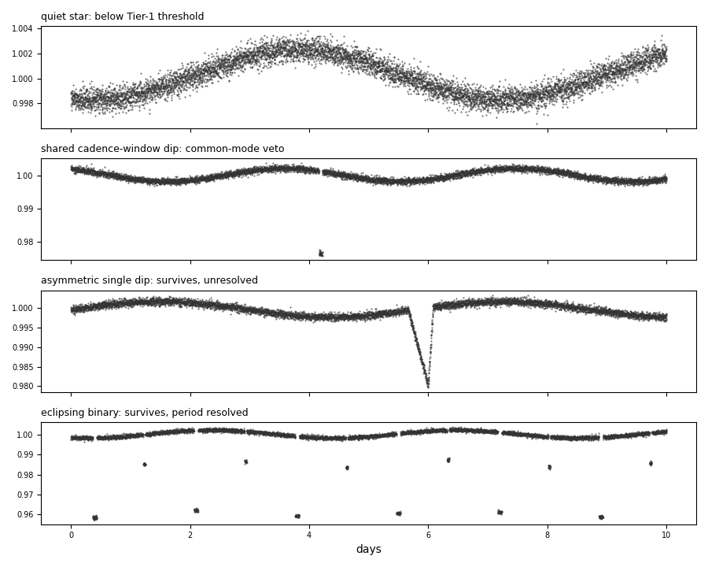
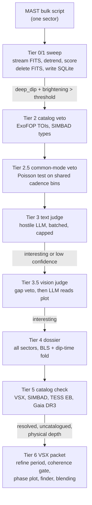

# Magpie

**A tiered TESS light-curve funnel: cheap mechanical filters sweep every star
in a sector, catalog and statistical vetoes remove the explained, and hostile
LLM judges (text, then vision) see only the few that survive.**



## Why it is interesting

NASA's TESS satellite publishes about 13,000 two-minute light curves per
sector, and most odd-looking ones have boring explanations: spacecraft
events, data gaps, known variable stars, eclipsing binaries. Magpie is a
funnel built around one principle: **spend judgment where it is scarce**.

- **Cost tiers.** Each stage is 10-100x cheaper than the next. Pure
  numpy/scipy filters score every star; network catalog lookups run only on
  the flagged subset; an LLM sees only what survives both, in capped batches.
- **The LLM is a hostile referee, not an oracle.** Its default verdict is
  "mundane", and it must construct the best mundane explanation before it may
  call anything interesting. "Uncatalogued variable star" counts as mundane.
- **LLM findings become free filters.** When the judge noticed that most
  early "anomalies" shared one cadence window across unrelated stars, that
  observation became a Poisson-tail common-mode veto that costs no tokens.
- **Text-judge blind spots got a vision tier.** The text judge could not see
  data gaps, and its first "interesting" calls were gap artifacts. Tier 3.5
  adds a mechanical gap veto plus a vision judge that reads the rendered plot
  and names the morphology (EB, dipper, flare, pulsator, single transit,
  artifact).
- **Gates that refuse.** Before a submission packet derives any number from a
  phase fold, a fold-coherence gate checks that the fold isn't smeared and
  refuses loudly if it is. That gate exists because a smeared fold once
  produced a confidently wrong eclipse depth.

The realistic output turned out to be modest and checkable: most "aperiodic"
anomalies fold cleanly once every sector of the star is stitched together,
so the pipeline's end product is **uncatalogued eclipsing-binary candidates**
with AAVSO VSX submission packets. [docs/design.md](docs/design.md) has the
original plan and how it changed.

## Architecture



| Module | Stage | Needs |
|---|---|---|
| `sweep.py`, `tier1.py` | Stream a sector's light curves through the filters into SQLite. Resumable, shardable. | network (MAST), curl |
| `tier2.py` | Veto known planet candidates (ExoFOP TOI list) and SIMBAD-typed variables | network |
| `common_mode.py` | Veto events that many unrelated stars share (spacecraft, not sky) | none |
| `tier3.py` | Batched hostile text judge | judge CLI |
| `plot.py`, `tier35.py` | Render plots + gap context; gap veto; vision judge | network, judge CLI |
| `tier4.py` | Multi-sector dossier: BLS period search, dip-time fold for eccentric EBs | network |
| `catalog.py`, `enrich.py` | Cross-match VSX, SIMBAD, TESS EB catalog, Gaia DR3; Gaia star facts | network |
| `packet.py` | VSX submission packet: refined period, epoch, coherence gate, plots, paste-ready fields | network |
| `hunt.py`, `watchdog.py` | Run a whole sector end to end; resume sectors whose hunt was killed | all of the above |
| `vsx_poll.py` | Check whether filed candidates have appeared in VSX | network |
| `demo.py` | Offline synthetic sector through the real sweep, veto and period code | none |

## Quickstart

Python 3.10+ and `curl` on PATH.

```bash
git clone https://github.com/nmcbride-42/magpie.git && cd magpie
python -m venv .venv && . .venv/bin/activate
pip install -e ".[dev]"

python -m magpie.demo --plot   # offline, ~10 s: synthetic sector through the funnel
pytest                         # offline test suite (~1 min)
```

The demo plants four classes of synthetic star and prints where each ends up:

```
  quiet        x24  tier1: below threshold
  common-mode  x8   tier2.5: common-mode veto
  dipper       x2   tier4: unresolved (too few events) -> LLM judges
  EB           x2   tier4: periodic, BLS P=1.70 d (dip fold resolves at 0.85 d)
```

The last line shows a real quirk rather than hiding it: dip times alone
cannot tell a period from its divisors, so the fold lands on P/2 when primary
and secondary eclipses look alike, and the dossier reports the flux-BLS
period instead.

### On a real TESS sector

```bash
python -m magpie.hunt --sector 95 --fetch-only                 # MAST bulk script -> data/
python -m magpie.sweep data/sector95_lc.sh --sector 95 --limit 200
python -m magpie.tier2 --sector 95                             # catalog veto
python -m magpie.common_mode --sector 95
python -m magpie.tier3 --sector 95 --max 16                    # text judge (LLM)
python -m magpie.tier35 --sector 95 --max-llm 4                # vision judge (LLM)
python -m magpie.tier4 --sector 95                             # dossiers for finalists
python -m magpie.catalog --sector 95                           # VSX/SIMBAD/TESS-EB/Gaia
python -m magpie.packet <TIC>                                  # submission packet
```

`python -m magpie.hunt --sector 95` runs all of it: 4 sweep shards with
restart-on-death, then every downstream stage, then an honest completion
report. A full sector is hours of downloading; run it under a process
supervisor.

### LLM judges

Tiers 3 and 3.5 shell out to a command that reads the prompt on stdin and
prints a JSON array. The default is the Claude Code CLI in print mode (`claude -p`); the vision
judge pre-approves only its `Read` tool so it can open the PNG plots. Point `MAGPIE_JUDGE_CMD` /
`MAGPIE_VISION_JUDGE_CMD` at any other command with the same contract.
Malformed verdicts are skipped and the candidate stays queued for the next
round.

## Configuration

All settings are environment variables; see [.env.example](.env.example).

| Variable | Default | Purpose |
|---|---|---|
| `MAGPIE_DATA_DIR` | `data/` in the repo checkout | DB, bulk scripts, FITS cache, plots, dossiers, packets |
| `MAGPIE_DB` | `$MAGPIE_DATA_DIR/magpie.db` | SQLite database |
| `MAGPIE_SHARDS` | `4` | parallel sweep shards in `hunt` |
| `MAGPIE_JUDGE_CMD` | `claude -p` | Tier-3 text judge command |
| `MAGPIE_JUDGE_MODEL` | unset | appended as `--model <name>` to the text judge |
| `MAGPIE_VISION_JUDGE_CMD` | `claude -p --allowedTools Read` | Tier-3.5 vision judge command |
| `MAGPIE_USER_AGENT` | `magpie/0.1` | User-Agent for catalog HTTP requests |
| `MAGPIE_DISCOVERER` | `<your name>` | Discoverer field in VSX packets |
| `MAGPIE_NETWORK_TESTS` | unset | `1` runs the archive-download tests |

No data ships with the repo. Everything is fetched from public archives
(MAST, ExoFOP, SIMBAD, VizieR, Gaia, VSX, SkyView) on demand.

## What is measured, and how

Everything below is reproducible from this repo.

**Offline tests (`pytest`, default):**
- Tier 1 on synthetic TESS-like noise: no false alarm on a quiet star; a
  planted 1%, ~5 h asymmetric dip is recovered and localized; asymmetric dips
  outscore symmetric ones of equal depth; slow-rise brightenings flag while
  fast-rise flares don't.
- The sweep's real code path (curl, FITS parse, quality mask, SQLite) on
  `file://` light curves, including resumability and recorded failures.
- Common-mode veto: a window shared by 10 unrelated stars is vetoed,
  independent events survive, and rerunning is idempotent.
- The demo's planted truth: every common-mode star vetoed, both dippers
  survive unresolved, both EBs resolved at the planted period.
- Period tools: BLS on stitched sectors; eccentric-EB dip-time fold; aperiodic
  dips refused.
- Packet numerics, each from a real failure: Gaia G/BP-RP to Johnson V
  matches the value VSX moderation computed (12.49); the epoch lands on the
  primary despite a secondary; period refinement recovers a 0.0003 d error
  over a multi-year baseline; the coherence gate passes a clean fold and
  refuses a smeared one.
- Judge plumbing with fake judges: malformed verdicts skipped and re-queued,
  per-run caps respected, vision shortlist selection.

**Network tests (`MAGPIE_NETWORK_TESTS=1 pytest -m network`):**
- Boyajian's Star (KIC 8462852), Kepler quarters 8 and 16: Tier 1 flags both
  dip episodes (`deep_dip > 50`).
- Injection-recovery on a real TESS curve (Pi Mensae): quiet baseline stays
  under threshold despite pi Men c's transits; a planted 1% asymmetric dip is
  recovered and localized.

**Not measured:** recall/precision of the full funnel on real sectors, and
the accuracy of the LLM judges against a labelled set. Thresholds were
calibrated by hand on early sectors. Treat the judges as a triage aid with a
known-conservative prompt, not a validated classifier.

## Limitations

- Tier 1 is deliberately blind to periodicity, so eclipsing binaries pass it
  freely; the catalog veto, judges and Tier 4 do the sorting.
- The 12-hour median detrend attenuates events lasting a large fraction of
  that window (there is a test pinning this), so very long dimming events
  score low.
- The dip asymmetry score compares area on either side of the deepest point,
  so a noisy flat-bottomed box can read as asymmetric.
- Common-mode alignment uses per-target cadence indices after quality
  masking, not absolute timestamps; it is approximate but tight in practice.
- SIMBAD and VSX coverage is incomplete. "Uncatalogued" means "not found by
  these queries", nothing more.
- There is no literature search. Absent from VSX (or the other catalogs
  queried) does not mean unpublished: one filed candidate turned out to be
  the subject of a published paper.
- `vsx_poll.py` can only tell "listed in VSX" from "not listed". Its
  "pending" covers awaiting review, returned for corrections, lapsed and
  deleted alike.
- The demo's synthetic stars are idealized (white noise, clean boxes). It
  shows the mechanics, not real-sky performance.

## Status

**Research prototype, used in earnest; external filings lapsed.** It was run
unattended over a series of recent TESS sectors in 2026. Two candidates were
filed with the AAVSO International Variable Star Index (VSX). Moderators
returned both for corrections in the first review round, and the submissions
were then allowed to lapse rather than resubmitted. One of the two filed
objects later proved to be a previously published dipper star, not a new
eclipsing binary; the catalog stage did not catch it because it had no VSX
entry. The moderation feedback is what drove the packet fixes described in
[docs/design.md](docs/design.md), including the fold-coherence gate, which now
refuses that kind of object. **Nothing here is a confirmed discovery.**

## How it was built

Designed by Nick McBride and built with his AI agent Iris (Claude-based) as
part of a personal research platform.

## License

MIT. See [LICENSE](LICENSE). TESS, Kepler, Gaia, SIMBAD and VSX data belong
to their respective archives; cite them if you use results from this tool.
